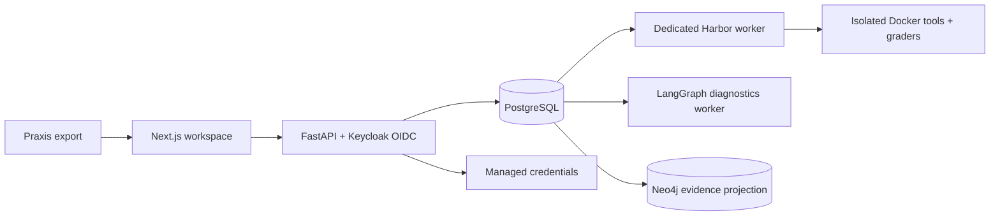

# ADI Anvil

**Frontier Evaluation & Diagnostics Platform — ADI Labs.**

Anvil turns versioned domain tasks into executable Harbor evaluations and inspectable
results. Praxis authors and exports tasks; Anvil validates the source, generates Python
verifiers and constraints, qualifies the supplied environment, and records runs against
immutable task, rubric, code, model and environment versions.

## Product journey

**YC review:** [modules and distinctive features](docs/product/MODULE-GUIDE.md) ·
[30-day product and SME taskbank roadmap](docs/build/11-30-DAY-ROADMAP.md) ·
[hosted URLs and sign-in](docs/runbooks/reviewer-sign-in.md) ·
[current review evidence](docs/generated/yc-review-2026-11-02.md).

**Import task → generate & validate → choose evaluation models → Run → inspect results → compare runs.**

The modern workspace is the application entry point. Admins configure models, credentials,
frameworks and people, and can perform all RL Engineer tasks. Engineers work with tasks,
run configurations, results and versioned edits. Previous URLs redirect to the workspace;
previous data is retained. The historical classic code remains in a rollback Git branch.

Generation uses an installation-wide model and a cumulative cap per import. Evaluation
models and budgets are separate. Green task readiness means a validated executable exists;
run admission also checks credentials, configuration, access and budget. No hidden
reference answers or private evaluator code are given to the candidate model.

## Architecture

For a product review, start with the [module definitions and distinctive features](docs/product/MODULE-GUIDE.md).
It explains Overview, Tasks, import generation, notebook editing, execution groups,
Benchmarks, run analysis/comparison, Models & keys, Frameworks, People and Limits & usage,
including each module's implemented behavior and limitations.



PostgreSQL owns canonical records, immutable versions, audit, budgets, jobs and checkpoints.
Neo4j is a rebuildable evidence projection. The API and ordinary worker have no Docker
socket. The dedicated Harbor worker runs supplied environments with network and resource
limits; private grading executes separately. Cloud generation keys use a designated
Secret Manager resource and workload identity; local keys use an encrypted private store.

| Directory                                                 | Responsibility                                                    |
| --------------------------------------------------------- | ----------------------------------------------------------------- |
| [apps/web](apps/web/)                                     | Next.js, React and TypeScript modern workspace                    |
| [services/backend](services/backend/)                     | FastAPI, LangGraph, domain services and SQL migrations            |
| [services/harbor](services/harbor/)                       | Independently locked Harbor runtime and tool agent                |
| [contracts/praxis](contracts/praxis/)                     | Export schemas and three synthetic golden tasks                   |
| [fixtures/executable-import](fixtures/executable-import/) | Original supplied Docker tools and reference checks               |
| [infra](infra/), [scripts](scripts/)                      | Local/cloud operations, checks and recovery                       |
| [docs](docs/)                                             | Architecture, product specifications, runbooks and dated evidence |

Read [architecture](docs/architecture/README.md), [execution runbook](docs/runbooks/workspace-execution.md),
[executable imports](docs/runbooks/executable-import.md), and [current build status](BUILD-STATUS.md).
Specifications describe intended behavior; dated test evidence describes what was verified.

## Run locally

Requires Docker, Node, pnpm10.34.5, Python and uv. Dependencies are independently locked.
See [local setup](docs/runbooks/local.md).

```sh
pnpm preflight
pnpm setup:local
pnpm dev
```

Open http://127.0.0.1:3202/workspace and sign in with your assigned Keycloak account.
Generated local demo credentials remain in ignored private files; no credentials are
published. `pnpm stop` stops app processes without deleting data.

## Tests and evidence

| Tests                                            | Location / command                                                                                                               |
| ------------------------------------------------ | -------------------------------------------------------------------------------------------------------------------------------- |
| Validation, scoring, credentials, policies       | [Unit tests](services/backend/tests/unit/): `pnpm test:unit`                                                                     |
| API, PostgreSQL isolation, ledgers and execution | [Integration tests](services/backend/tests/integration/): `pnpm test:integration`                                                |
| OIDC, import, readiness, runs and comparison     | [Browser tests](tests/e2e/): `pnpm test:e2e`                                                                                     |
| Lint, formatting, contracts and production build | `pnpm check`                                                                                                                     |
| Three golden import-to-Harbor cases              | [Golden contract](contracts/praxis/golden-v3/README.md), [acceptance evidence](docs/generated/executable-import-build-report.md) |

Native integration checks require explicit local Docker/Harbor configuration and isolated
test databases. Do not run them against deployed user data. Software conformance uses
controlled provider responses and real isolated tools/Harbor; it is **not live model
performance**. See BUILD-STATUS for exact current counts, failures and not-run checks.

## Hosted deployment

Use the [verified URLs and sign-in steps](docs/runbooks/reviewer-sign-in.md) for both
Anvil and Praxis. That guide distinguishes current checks from historical release evidence.

See the [verified YC release report](docs/generated/yc-release-2026-11-01.md) for exact
deployed revisions, backups, test evidence and remaining live-test limitations.

[Anvil workspace](https://anvil-34-36-217-66.sslip.io/workspace).
Use the [cloud-ready golden imports](contracts/praxis/golden-v3-cloud/README.md) on this host;
the original local set binds a different, local-only image identity.
Sign in with your assigned invited account. Existing users/data are preserved.
See [GCP deployment configuration](infra/gcp/deployment.json) and [release plan](docs/build/09-YC-PUBLIC-RELEASE.md)
for the last verified version and rollout evidence. Source publication does not prove deployment.

The existing host uses Compute Engine, a private VM, HTTPS load balancer, PostgreSQL,
Neo4j, Keycloak, and a dedicated Harbor worker. Generation is separately authorized for
OpenAI gpt-6.1-sol at a $10 whole-import cap. Harbor evaluation remains gated by exact
model/key versions, current Admin authorization and reserved budgets; ordinary live
inference and real email remain disabled. See BUILD-STATUS for measured readiness:
software verification and generated-package readiness do not establish paid model performance.
No API keys, passwords or private datasets belong in this repository.
Notebook editing is a download/Colab-or-Jupyter/upload workflow with server revalidation;
it does not provision hosted notebook runtimes. Only supplied qualified environments run.

Benchmarks integrates the existing TaskProfile/catalog/recommendation workflow into the
modern workspace. Catalog registration is metadata only, and the matching path remains
limited to qualified static synthetic diagnostics. Full expert TaskBanks and the
Anvil → Praxis SME review → Anvil results API loop are planned in the 30-day roadmap.
The roadmap targets 200–500 expert-authored samples per domain; these are not current counts.
