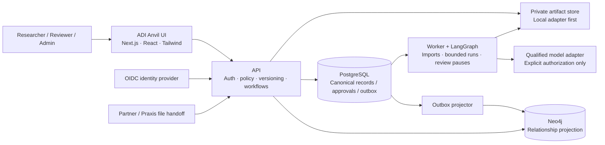

# ADI Anvil — MVP v1.0 Engineering Build Specification

**Frontier Evaluation & Diagnostics Platform**

Version: 1.0 · 27 September 2026 · Engineering baseline for review, not implemented software

ADI-Anvil handoff note: the current [overnight build overlay](../build/01-OVERNIGHT-BUILD-SPEC.md) selects the new ADI-Anvil repository, approved stack, all milestones and multi-provider adapters. It supersedes older location/sequencing/provider defaults while retaining the controls below.

## 1. Start here

Build one independent, local-first evaluation application for the **Business Case Diagnostics 200** offering. It accepts incomplete partner case packs, makes gaps visible, qualifies versioned tasks and rubrics, executes a bounded diagnostic protocol, supports human adjudication, and exports reviewed evidence. The target is a 200-case inventory; actual qualified and evaluated counts depend on supplied materials and rights.

This document and its companions form one engineering specification:

1. This file: scope, architecture, permissions, screens, evaluation and operational rules.
2. [Database, graph and API contracts](15-MVP-DATA-AND-API-CONTRACTS.md).
3. [Build sequence, test plan and coding prompt](16-MVP-BUILD-AND-TEST-PLAN.md).
4. [Brand and UI handoff](17-ANVIL-BRAND-AND-UI.md), including the [interactive review mockup](mockups/adi-anvil-v1.html).
5. [Automated Sales Kit](18-AUTOMATED-SALES-KIT-SPEC.md): one-page benchmark digest, email draft and approval-controlled dispatch, added at the user's request.

For this MVP, these implementation defaults narrow the broader F01–F10 product vision. They do not remove that roadmap. Confirmed user directions remain binding; recommended engineering decisions below are explicit defaults, not claims that the user approved every technical detail. No real evaluation, paid provider call, cloud deployment, Git publication or external delivery is authorized by a specification alone.

## 2. Confirmed direction and selected defaults

| Item | Decision | Authority |
| --- | --- | --- |
| Product name | ADI Anvil | User selected |
| Tagline | Frontier Evaluation & Diagnostics Platform | User selected; exact wording |
| Brand | Extend the supplied ADI Labs infinity logo and palette | User selected; generated derivative needs visual approval |
| Frontend | Same framework/design family as existing ADI applications; Praxis is the inspected reference | User direction; interpreting the reference as Praxis is an explicit assumption |
| Transaction database | PostgreSQL for CRUD and authoritative operational records | User selected |
| Agent orchestration | LangGraph, Python implementation | User selected LangGraph; Python is the engineering baseline |
| Graph database | Neo4j for relationship traversal and diagnostic lineage | Engineering recommendation; user requested a graph database, not a named vendor |
| Initial service shape | Independent Next.js frontend, Python API, separate durable worker, PostgreSQL, Neo4j, private artifacts | Engineering default |
| First execution surface | Static document-to-deliverable cases; fixture adapter and optional bounded Responses adapter; external result import | Engineering scope default, not evidence that all Bodhium cases fit it |
| First delivery | Private reviewed report/evidence pack plus automatic one-page Sales Kit preparation and explicitly approved email dispatch | Sales Kit user-requested; generation/send safety controls in its specification; customer portal deferred |
| Assessment | Deterministic checks plus evidence-linked human grading; no autonomous judge as final authority | Engineering default |
| Graph authority | PostgreSQL commits versioned facts; Neo4j is a rebuildable projection, not a second approval/score authority | Engineering default |

Do not infer that a graph database is a learned TTM, that a model failure graph reveals internal reasoning, or that all 200 cases are long-horizon interactive environments.

## 3. What v1.0 includes

**Happy path:** sign in → create objective → researcher/advisor recommendations → Product Owner scope approval → import cases → resolve gaps and rights → expert/research qualification → publish custom suite → freeze protocol → authorize run → explicitly launch → capture outputs → human review → failure diagnostics → approve report → build/download permitted pack.

| Area | Must ship in v1.0 | Later, not hidden unfinished MVP work |
| --- | --- | --- |
| Access | OIDC login, invitation-only project membership, role checks, audit, two-Admin paid/activation approvals | Self-service customer tenancy, marketplace, billing |
| F01 | Both origins; capability-led or benchmark-led brief; immutable review revisions and measurement plan | CRM automation, autonomous research planning |
| Intake | Partner manifest + private attachments, original snapshot, gaps, versioned enhancements and rights | Scraping, automatic case synthesis, live Praxis synchronization |
| Qualification | Reference/rubric review, capability/family mapping, exposure flags, separate test/development labels | Full SME authoring/recruitment inside Anvil |
| Suite/protocol | Custom suite, pinned cases/harness/scoring/budgets, exclusions and repetitions | Official GDPval connector or public leaderboard |
| Execution | Fixture runner; optionally activated single-response model baseline; labeled external run import | Arbitrary uploaded agent code, free-form tools, browsers, shell sandboxes, interactive simulators |
| Review | Blinded output review, 0–4 anchored rubric dimensions, disputes and adjudication | Autonomous high-stakes grading, learned verifier training |
| Diagnostics | Evidence-linked findings and read-only case/capability/failure graph | Full TNG authoring, learned TTM, graph-guided agent execution |
| Reporting | Scorecards, exclusions, evidence provenance, reviewed Markdown/HTML/CSV/JSON bundle; automatic one-page PDF Sales Kit and email draft with approved sender/recipient dispatch | PPTX/DOCX automation, unreviewed mass outreach, automatic Notion publishing |
| F05 | Not required for diagnostic delivery; protected content marked non-exportable for learning | Training-pack builder, optimization, Tinker/H100 jobs |

Cases requiring tool use or stateful interaction receive `unsupported_execution_mode`, not a false model failure. Their intake, gap ledger and partner-reported evidence may still be stored. A customer-owned agent can supply the external-result contract without adopting an ADI model. Direct execution of that agent needs a later qualified adapter.

## 4. Architecture and component ownership



The projector can run as a worker job type, not an extra microservice. No browser-to-database access. No synchronous dual writes. API authorization, run freezing and reports consult canonical PostgreSQL records, never a possibly stale graph.

### 4.1 Frontend baseline

Use **Next.js App Router, React, TypeScript, Tailwind CSS**, matching Praxis. Inspected Praxis files currently declare Next 15.5.26, React 19.3.0, Tailwind 4.3.3, TypeScript 5.9.3, pnpm 10.34.5 and Node >=22. These are observed manifest values, **not independently validated dependency compatibility or security status**. At build phase 0 resolve supported compatible patches, review advisories, install independently and commit Anvil's own lockfile. Do not blindly copy a stale lockfile or import `@praxis/shared`.

Use the same navy header, gradient accent, light/dark themes, rounded cards, form patterns and role-aware navigation. Copy only explicitly selected visual tokens/ideas into Anvil-owned files. Accessibility may require darker semantic button/text colors while preserving brand accents. Product UI and storage keys use `anvil`, never `praxis`.

### 4.2 Backend baseline

Python 3.12, FastAPI, Pydantic 2, SQLAlchemy 2, Alembic, psycopg 3, HTTPX, Authlib, **LangGraph**, `langgraph-checkpoint-postgres`, official Neo4j Python driver and ReportLab for the one-page PDF; pytest and Ruff. Use `uv.lock`. One API and one worker process locally; queue semantics are in PostgreSQL. No Redis, Kafka or Kubernetes prerequisite. Package versions and container digests are pinned during phase 0 and tested together; this document does not assert untested exact package compatibility. LangSmith/Agent Server subscriptions and external trace uploading are not required and are disabled by default.

Use PostgreSQL 17 as the selected major. Use Neo4j Community for isolated local development, with an exact compatible release pinned during phase 0. Evaluate production edition, licensing, backup and tenant isolation separately before hosting customer data. Community supports one standard database; this MVP must not rely on one database per project in that edition. [Neo4j database administration](https://neo4j.com/docs/operations-manual/current/database-administration/).

### 4.3 Database responsibilities

| PostgreSQL — canonical | Neo4j — graph projection | Artifact store — bytes |
| --- | --- | --- |
| Users, memberships, objectives, cases/versions, rights, gaps, rubrics, suites, protocols, runs, assessments, findings, approvals, costs, reports, releases, audit/outbox | Case-family-capability relationships, version lineage, rubric coverage, observed finding links to episodes and evidence IDs; optional imported procedural structure kept separately typed | Original files, normalized actor inputs, hidden references, candidate outputs, permitted event traces, rendered reports and manifests |

A relationship editor writes validated canonical relations through the API. The outbox updates Neo4j afterward. No manual Neo4j console writes are supported product operations. Graph failure does not block core CRUD or previously frozen assessments; graph views show unavailable/stale status rather than silently claiming current results. Exports obtain relationship snapshots from PostgreSQL.

### 4.4 Local-first structure

```text
ADI-Anvil/                      # newly selected independent repository
  apps/web/                     # Anvil-owned UI
  services/backend/src/anvil/    # API/domain + separate worker entrypoint
  services/backend/migrations/  # independent Alembic migrations
  contracts/                    # generated OpenAPI and versioned interchange schemas
  tests/{unit,integration,e2e,fixtures}/
  infra/local/                  # Compose, identity realm template, no real secrets
  assets/brand/
  docs/
```

This is a proposed future layout; those application services have not been generated. Local Compose runs PostgreSQL, Neo4j and a development-only Keycloak identity provider; API/web/worker may run as processes or containers. Ports are configurable to coexist with Praxis: proposed web 3200, API 8200, PostgreSQL 5542, Neo4j HTTP 7475/Bolt 7688, identity 8180. Bind development ports to loopback. Keycloak development mode is not production configuration. [Keycloak local Docker guide](https://www.keycloak.org/getting-started/getting-started-docker).

Frontend uses a same-origin `/api/v1` proxy to the API. Business state changes stay in the API. Infrastructure substitution later uses `ArtifactStore`, `SecretResolver`, `CandidateAdapter`, `IdentityProvider` and `GraphRepository` interfaces; cloud deployment still needs IAM, TLS, backup, network and configuration work. Do not promise zero deployment work.

### 4.5 LangGraph agent execution contract

Use a typed LangGraph `StateGraph` inside the worker. It orchestrates the assessment harness; it is not the semantic database. PostgreSQL-backed checkpoints persist graph progress, while canonical application tables retain approved protocol, episode, budget and review facts. Neo4j serves relationship exploration. Neither a LangGraph edge nor a Neo4j edge establishes learned TTM intelligence.

MVP graph: `load_frozen_context → validate_authorization → prepare_actor_input → invoke_candidate → capture_output → deterministic_checks → await_human_review → finalize_assessment → END`. Validation failure routes to a blocked result; ambiguous provider completion routes to reconciliation, not back to `invoke_candidate`. Candidate refusal/task failure still reaches review. The static reference candidate may be one model call; using LangGraph does not turn that into a proven long-horizon agent. Later planner/tool/revision subgraphs need their own specification and frozen harness versions.

Use one server-generated LangGraph thread UUID per episode, mapped to project/run/episode in PostgreSQL. Clients never select a raw thread ID, checkpoint ID, node or arbitrary resume payload. Graph state stores identifiers, immutable version hashes, step counters, approved budget reference and output artifact IDs—not hidden references, credentials, private chain-of-thought or a cross-case conversational memory. Candidate state is reset between cases. Reviewer/reference retrieval is isolated from candidate nodes.

Compile with a durable PostgreSQL checkpointer, not an in-memory saver except in unit tests. Run its setup/migrations through the migration job with separate credentials and a tested dedicated `anvil_checkpoints` schema/search path. The library owns checkpoint-table internals; no application code edits them directly. Checkpoint access is worker-only through a project-authorized thread registry; never expose saver history APIs to browsers. Include checkpoints in retention, backup and deletion planning. [LangGraph persistence](https://docs.langchain.com/oss/python/langgraph/persistence).

Use `interrupt()` for the human-review pause. Return a persisted pending-review identifier, release the worker lease, and retain no busy polling job while a human is away. An authenticated review action writes a canonical adjudication and a unique resume job atomically; the worker resumes through a server-constructed `Command(resume=...)` only after checking current role, version, pending interrupt and decision revision. Duplicate/stale resumes return the stored result or a conflict. Review rejection cannot silently retry inference. A cancelled or invalidated episode cannot resume.

Resumption can re-enter node code; side effects before an interrupt must be idempotent. Persist paid dispatch/result through the canonical call ledger; graph checkpointing alone does not ensure exactly-once external execution. Wrap external effects in discrete tasks/nodes, but still reconcile a crash after inference and before checkpoint persistence. Keep graph version/code digest pinned to a thread; do not resume an old checkpoint using incompatible new node order. Budget and cancellation checks apply at every side-effect boundary. Proposed recursion cap 20 for this finite MVP graph, with explicit error on cap rather than silent looping. [LangGraph interrupts and resumption](https://docs.langchain.com/oss/python/langgraph/interrupts).

The lab can use any agent framework. LangGraph is Anvil's internal stack, not a requirement on customer models or externally imported agents. Calling an LLM through a vetted adapter from a LangGraph node is sufficient; do not force every provider through a LangChain model wrapper or expose extra hosted tools by default.

## 5. Identity, permissions and review separation

OIDC authorization-code flow with PKCE, state and nonce; validate issuer, audience, expiry and signature. Backend exchanges code and issues an opaque session cookie; database stores only a session-token hash. Cookie is HttpOnly, SameSite=Lax, Secure outside loopback development; mutations require CSRF token plus Origin validation. Logout revokes the server session. Tokens/secrets never enter browser storage. Issuer+subject is the identity key; matching email alone cannot link identities. No open registration. Roles derive from Anvil membership, not client-submitted claims.

Proposed session defaults: 30-minute idle expiry, 8-hour absolute expiry; reauthenticate within 10 minutes for secrets, membership grants and paid/release approvals. Require MFA at the identity provider before non-local activation. Seeded local identities are explicitly development-only; startup refuses them in production mode.

Project scope is mandatory for all business permissions. Admin is not blanket customer-content access. Assign a project role as well where content access is needed.

| Role | Allowed | Not allowed solely by this role |
| --- | --- | --- |
| Researcher | Objective technical fields; task/rubric proposals; suites/protocols; launch approved runs; findings/report draft | Approve own scientific judgment; change final grades without correction |
| Advisor | Assigned briefs, recommendations, assigned technical reviews | Execute/pay/export by default |
| Sales | Objective business fields; approved sales-visible summaries | Hidden references, raw test outputs, scoring edits, execution |
| Selected customer researcher | Invited objective collaboration; explicitly customer-visible approved evidence | Internal notes, hidden references, other customer/project records |
| Product Owner | Scope approval, release audience approval and final release approval | Override missing rights or scientific disputes; spending by default |
| Data Engineer | Intake, artifacts, gaps, canonical publication after review | Invent source rights or approve own content meaning |
| Domain Reviewer | Reference/rubric review, assigned case grading/adjudication | Provider activation/spending, unassigned customer content |
| Admin | Identity/connection administration, bounded execution authorization | Self-satisfy two-Admin control; silent alteration of research evidence |

MVP default F01 quorum: one Researcher and one Advisor recommend, a third Product Owner approves; all distinct authenticated users and bound to the exact submitted revision. Domain content review must be by someone other than the enhancement author. Scientific protocol/report review must be by an assigned Researcher or Advisor other than the author. Domain approval is required when a report interprets business judgments. Real named staff can hold multiple roles but cannot fill two separated positions on the same decision. Small-team staffing is a production-readiness decision, not a reason to bypass tests.

## 6. Intake, rights and qualification

Data Engineer uploads individual private files, then submits a JSON case manifest referencing their artifact IDs. No arbitrary URL fetching, directory upload, ZIP execution or code execution. Supported storage types: PDF, DOCX, XLSX, CSV, TXT, JSON, PNG/JPEG. Maximum file 25 MiB, 30 files/case, manifest 2 MiB, 200 cases/import; configurable downward per deployment. Reject encrypted/password-protected, macro-enabled, executable and unsupported files. MIME sniffing, decompression/resource limits and malware scanning precede accepted storage. Scanner unavailable means quarantined, not clean. Pure in-repository text fixtures may use a clearly labeled test-only bypass; real uploaded materials cannot.

For v1.0, a human supplies/reviews normalized UTF-8 actor text or approved JSON/table renderings. Storing a spreadsheet/PDF does not imply a correct OCR/parser or automatic model attachment. Original source bytes remain immutable and separately permissioned. Input completeness is checked against the task manifest; missing exhibits block qualification. Documents are untrusted data, never instructions to infrastructure/tools.

Track each readiness item: source identity, evaluation rights, external processing rights, actor inputs, task definition, reference, rubric, execution compatibility, calibration. Values: `available`, `partial`, `missing`, `not_applicable`; require explanation/evidence for not applicable. Rights include operation, destination/recipient, expiry, evidence and review status. Unknown does not grant permission. Managed evaluation, report sharing, raw redistribution, derivative creation and training are different grants.

Qualification requires expert-approved reference/rubric, research approval, defined family/capability mappings, known exposure label (including `unknown`), supported mode, valid actor/reference separation and all operation-specific prerequisites. Data Engineer explicitly publishes the approved task version. Any material change creates a new version; existing results stay attached to the old version. Rights revocation blocks future egress immediately and flags impacted reports without rewriting history.

## 7. Evaluation, scoring and diagnostic validity

### 7.1 Protocol freeze

Freeze objective revision; suite/member versions; actor artifact hashes; hidden reference/rubric versions; capability ontology; candidate ID/requested model and harness version; adapter/version; prompts; supported generation settings; input/output/time caps; repetitions/seed policy; scoring/pass rules; exclusion rules; exposure/grouping; reviewer assignments; cost rate version and maximum spend; permitted destination. Unsupported settings cause validation errors, not silent ignoring. Empty measurement plan or absent pass policy blocks review.

MVP default repetitions = 1 for pipeline testing; scientific repetitions and precision expectations must be set in each real protocol. No assumption that temperature 0 or a seed guarantees reproducibility. A small pilot can be descriptive only. A paired comparison must use compatible cases/conditions and show matched denominators. Uncertainty analysis is not fabricated from repeated attempts treated as independent cases; v1.0 emits descriptive counts and explicitly `uncertainty_not_estimated` unless a separately validated method is added.

### 7.2 Candidate adapters

`fixture_static_v1`: deterministic synthetic outputs/errors for tests; no network; all evidence `illustrative`. Cannot be promoted to measured evidence.

`openai_responses_static_v1`: optional server-side reference adapter, single bounded response per episode using approved normalized actor input. No web search, tools, hosted files, background mode, persisted conversation, shell, arbitrary endpoint, or hidden reference attachment. Use configured compatible model ID; record requested/returned model, SDK/adapter version and provider request ID where available. Disable automatic SDK retries for ambiguous paid execution; recovery is below. Set `store=false`, but do not claim that this alone guarantees zero retention or authorizes provider processing. Verify actual account/model capabilities and data terms before activation. Responses is an interface option, not a requirement to use an ADI/OpenAI model. [Official Responses guidance](https://developers.openai.com/api/docs/guides/migrate-to-responses).

`external_result_import_v1`: ingest already-produced customer/partner outputs and supplied manifests through upload validation. Preserve `customer_reported`/`partner_reported` origin and execution date/configuration uncertainty. Local human grading may be ADI-reviewed; original execution is still not ADI-executed. No inferred intermediate trajectory. This supports labs' own models/agents while a direct integration is pending.

### 7.3 Execution authorization and cost

Provider activation and paid run scope each require two distinct Admin approval records on exact hashes, active membership, destination and ceiling. A user with both roles cannot approve twice. Authorization expires after a proposed 24 hours or on bound configuration/rights change. Authorization is not launch: an assigned Researcher explicitly launches with idempotency key. Fixture mode needs explicit launch and normal content/protocol permissions but no fictitious spend approval.

Before enqueue, atomically reserve the run's conservative upper-bound cost in PostgreSQL. Unknown pricing cannot be treated as free. Maximum attempts, input/output tokens and time must have enforceable limits; include supported billable token categories and overhead. Block live adapter activation if a defensible bound cannot be set. Default global live concurrency 2; per run 1; no automatic retries of model execution. Stop admitting new episodes on cancellation, revocation, budget exhaustion or provider uncertainty. Report provider usage separately from estimates/reconciliation; never invent an actual cost.

Persist dispatch intent before contacting the provider. A crash/timeout after dispatch without a trustworthy result is `execution_unknown`, not a retryable empty result. Do not resubmit automatically. An Admin reconciles with provider records where available, or marks cost/result unknown and approves a new bounded attempt separately. Exactly-once external inference is not promised. A transport timeout does not prove provider cancellation.

### 7.4 Assessment and grading

Execution state and scientific outcome are separate. An output can complete successfully at infrastructure level and fail the task. Outcomes: `pass`, `fail`, `invalid`, `unscorable`, `pending_review`. Invalid reasons include missing task input, reference ambiguity, harness/tool defect and grader defect; provider failure is operational, not model failure. A refusal with valid supplied inputs can be scored as noncompletion only under the frozen rubric, with its observable reason preserved.

Rubric dimensions have immutable IDs, capability mappings, weight in basis points totaling 10,000, and explicit anchors for integer scores 0–4. Required evidence identifies output span/artifact and reference criterion. Score = sum(weight × dimension_score/4)/100, yielding 0–100. A predeclared critical violation overrides numeric pass. Pass threshold is rubric/protocol-specific; no universal business-intelligence threshold. Missing dimension judgment means unscorable/pending, not zero. V1.0 does not dynamically renormalize N/A dimensions: publish a suitable rubric version before running.

Two independent reviewers grade calibration examples and an assigned initial pilot; reviewer independence and sample coverage are recorded. Production grading defaults to one independent Domain Reviewer, with a second required for all critical failures, borderline scores (within 5 points of threshold), disputed judgments and an explicitly sampled 10% of other episodes. Sampling rule/seed is frozen before results. Any two-reviewer pass/fail or critical-violation disagreement, or dimension disagreement of 2+ points, goes to a third assigned Domain Reviewer for adjudication; do not average away the dispute. Every reviewer must see facts/allowed alternatives, not model identity where practical. Reviewer 2 is blind to reviewer 1 until submission. These are proposed engineering defaults, not proof of rubric reliability.

Calibration sign-off records fixtures covering clear pass, clear fail, alternative valid answer, critical error and ambiguous reference, observed agreement/disagreements and justification. Real reliability/acceptance thresholds must be approved in the protocol; no live study can silently inherit fixture thresholds. No automated LLM judge is required in v1.0. Deterministic checks run only vetted server-defined validators, never uploaded expressions or code.

### 7.5 Findings and reports

Findings link episode, rubric criterion, observed evidence and capability; classify `candidate`, `harness`, `tool`, `task`, `reference`, `grader`, `infrastructure`, `unknown`. Store observation separately from causal hypothesis and alternatives. Final-answer-only evidence cannot establish the first failing internal step. No private chain-of-thought collection. Read-only graph exploration shows lineage, coverage and observed failure links; it does not infer causality.

Report valid pass/fail denominator, launched/planned/aborted/unknown/invalid/unscorable counts, exclusions and selection/exposure limits. Score averages include only scored episodes and state the denominator; report case and family counts separately. No denominators silently drop failed infrastructure jobs. Imported and illustrative evidence are separate strata, never pooled as ADI-executed performance. The whole-system label includes model+harness. No GDPval, Harvard/Wharton endorsement, MBA human comparison or uplift claim without matching evidence.

## 8. Screens and interaction requirements

| Route under project `/p/{project_id}` | Purpose and primary action | Required blocked/empty state |
| --- | --- | --- |
| `/objectives` and `/objectives/{id}` | Create brief, measurement plan, submit/recommend/approve exact revision | No approved objective; missing field/review list; stale edit conflict |
| `/cases` and `/cases/import` | Inventory, manifest validation preview, commit permitted import | 200 planned vs actually received/qualified; row-level errors; quarantine |
| `/cases/{id}` | Source/versions, gaps, rights, actor/reference tabs, proposed enhancement, qualification | References hidden by role; missing rights shown as blocking |
| `/rubrics/{id}` | Dimensions/anchors, evidence and calibration, review | Weights invalid, uncalibrated, reviewer conflict |
| `/suites/{id}` | Exact task membership, family/exposure split, freeze | Duplicate family leakage; unqualified/unsupported members |
| `/protocols/{id}` | Candidate/config, budgets, grading, review, authorization | Missing measurement/pricing/destination approval; no automatic launch |
| `/runs/{id}` | Explicit launch, per-episode status, cost status, cancel request | Unknown execution, partial/cancelling, invalid vs candidate failure |
| `/reviews/{episode_id}` | Blind assessment, evidence and dispute resolution | Missing dimensions, own-work review, conflicting adjudications |
| `/diagnostics` | Case-capability-finding graph + equivalent table/evidence panel | Graph syncing/unavailable; filtered visibility; no invented edges |
| `/reports/{id}` | Draft, evidence/technical/domain review, audience approval | Unresolved dispute; illustrative watermark; rights revocation |
| `/releases/{id}` | Manifest review, explicit build, authorized download | No redistribution rights; stale approval; export still building |
| `/sales-kits/{id}` | Automatically prepared one-page digest, email draft, scientific/audience review, exact-recipient send | Provisional results, unknown evidence, stale claims, unconfigured sender or unapproved recipient |
| `/settings` | Assigned roles, connection/version/activation approvals, audit | Secret is write-only; activation not tested/approved |

Login shows the full product logo/tagline. Header uses accessible live text and an infinity mark, not a rasterized unreadable tagline. Existing role changes cause server denial even if a stale browser still shows a control. Save progress never launches a model or releases files. Use loading/error/empty/permission-denied states; keyboard labels, table headers, focus management, 320px reflow and dark mode are required. The review mockup demonstrates navigation and evidence states only; its synthetic fixture is not Bodhium's actual data.

### 8.1 Automatic sales handoff

Run completion creates an internal provisional digest job; approved scientific report completion refreshes the digest into an exact-version one-page PDF/HTML, email draft and internal Sales briefing. Use deterministic templates, no automatic paid model generation. Sales edits positioning and selects permitted contacts; independent scientific/audience checks precede the explicit send action. Fixture sender tests are in v1.0; real mail credentials, sender identity and recipient approval are enablement gates. No arbitrary contact list, old thread recipient reuse or unreviewed bulk send. See [full Sales Kit contract](18-AUTOMATED-SALES-KIT-SPEC.md).

## 9. Security and operational requirements

Apply project-scoped authorization on every endpoint, artifact stream, graph node/edge and background job. Parameterize SQL/Cypher; never accept free-form query language. Graph traversal is bounded and project/visibility filtered at every hop. Internal/hidden content cannot be exposed through labels, edges, counts, search or export. Reviewer privilege is not candidate-runner privilege. Load actor artifacts through a separate allowed view; runner cannot request reference IDs.

Artifact IDs resolve to server-owned paths; reject traversal/symlinks and client-chosen storage paths. Never render uploaded HTML/scripts. Safe text rendering/CSV formula escaping; reject embedded executable macros. Dedicated parsing/scan limits and worker processes contain decompression and parser risks. Secrets are environment/secret-store references, never plaintext database fields or public `NEXT_PUBLIC_*` variables. Redact telemetry; no prompts, responses, documents or credentials in routine logs.

Database migrations use a separate owner credential. App/worker roles are non-owner, non-superuser and do not have BYPASSRLS. Row-level isolation supplements application checks; set project/user context inside each transaction, reject missing context, reset on connection reuse, test cross-project paths and foreign keys. [PostgreSQL row-security behavior](https://www.postgresql.org/docs/17/ddl-rowsecurity.html).

Local secrets and artifacts are ignored by Git. Logs retain IDs, statuses, duration, token/cost metadata and correlation IDs; raw evidence stays private. Proposed default technical log retention 30 days; source/run artifact retention is project-configured before accepting real material and must not exceed permissions. No unapproved automatic deletion in this build spec. Retention/legal hold/deletion ownership must be configured before real-data operations. Revocation creates a tombstone and export block immediately; physical purge is a separately audited action, including backups as applicable.

Health separates API, DB, worker and graph readiness; metrics include queue age, lease expiry, unknown executions, run failures, outstanding reservations, projection lag and blocked exports. Graph-down can be degraded healthy; PostgreSQL-down is not. Record operational limits honestly; no high-availability promise from local containers.

## 10. Build/release gate

Build from synthetic fixtures now once coding is authorized. Real-data pilot additionally needs permitted sample materials, named reviewers/approvers, actual provider terms/pricing/credentials, calibrated rubric/protocol, production-grade upload scanning, retention and approved destinations. These are operational gates, not excuses to stop building the local application.

The MVP is complete only when the phase acceptance tests in [the build plan](16-MVP-BUILD-AND-TEST-PLAN.md) pass on a recorded build. A UI preview, a written spec, a populated graph or a successful API request alone is not an evaluation product. There is no promised delivery date or benchmark improvement in this document.

## 11. Source basis

Product scope: [confirmed decisions](DECISIONS.md), [SKU](13-BUSINESS-CASE-DIAGNOSTICS-SKU.md), [Praxis boundary](11-PRAXIS-FRONTIER-INTEGRATION-SPEC.md). Local frontend reference inspected 27 September 2026: Praxis `apps/web/package.json`, `packages/shared/theme/theme.css`, `tokens.ts`, console layout and brand component; independent design reuse only.

Technical references checked 27 September 2026: [Next.js installation](https://nextjs.org/docs/15/app/getting-started/installation), [FastAPI container deployment](https://fastapi.tiangolo.com/deployment/docker/), [PostgreSQL queue locking](https://www.postgresql.org/docs/17/sql-select.html), [Neo4j Python transactions](https://neo4j.com/docs/python-manual/current/transactions/), [Keycloak OIDC](https://www.keycloak.org/securing-apps/oidc-layers). These support technology mechanics, not performance, license approval or Anvil implementation claims. Protocol/architecture choices above are ADI engineering recommendations.
