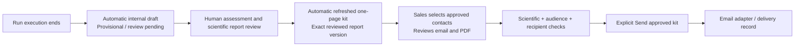

# ADI Anvil — Automated Benchmark Sales Kit

Version: 1.0 · 27 September 2026 · Added to MVP v1.0 specification

**User requirement:** after a benchmark run, produce an easily understood one-page sales summary and a kit that Sales can send to frontier labs. This is an addition to the Anvil evaluation product, not a new CRM or permission to send any email now.

## 1. Product outcome

Turn a reviewed run into a concise commercial conversation starter with an auditable scientific basis. Sales should understand in two minutes: what was tested, what happened, why it may matter to a lab, what ADI can offer next, and which claims must not be made.

Deliver one versioned `SalesKit` containing:

1. **One-page PDF** with ADI Anvil logo/tagline, also available as accessible HTML.
2. **Plain-text email draft** with subject, short pitch, approved call to action and permitted evidence link.
3. **Internal sales briefing**: discovery questions, likely objections, suggested next experiment, claim boundaries and capability availability labels. This is not included in the external PDF/email by default.
4. **Evidence manifest** pinning report/run/protocol/suite/finding versions, origin, review status, rights, audience, recipients and checksums. Internal audit metadata is not automatically included in the customer attachment.

Do not use “benchmark win,” “best model,” “MBA-level failure,” “Harvard/Wharton endorsed” or revenue claims unless the specific approved study supports them. A custom suite is identified as a custom suite. A data-source domain becomes context, not an unsupported claim about domain superiority.

## 2. Automation boundary

Default v1.0 behavior is **automatic preparation, human-approved external sending**. This is the recommended implementation of the requested automated kit, pending the user's review. There is no standing authorization to email unspecified labs.

When a run finishes, enqueue an idempotent, non-model `sales_kit.prepare` job. If scoring/review is incomplete, create only an internal draft marked **PROVISIONAL — NOT FOR EXTERNAL USE**, with unknown metrics explicitly unavailable. No external download/send authorization exists for this draft.

When the scientific report becomes approved, create a new immutable kit revision using its final assessment/finding set. Review previously generated copy against the changed facts; never silently reuse a stale kit. A negative or inconclusive finding is a valid draft outcome; no unsupported positive narrative is generated to fill the page. Repeated completion events produce one revision for the same report/configuration hash.

Default generation uses **deterministic templates over approved facts**, so completion does not trigger a paid LLM call. Optional future wording assistance requires separate generation authorization, permitted data egress, bounded spend and review. This is not part of v1.0.

First implementation can use a fixture mail adapter and an `.eml`/text draft; the real sender adapter stays disabled until a named ADI sender, recipient policy and credentials/scopes are configured and tested. External dispatch is a separately authorized user action. Do not assume this specification itself grants Gmail access or import earlier thread recipient lists into this product.

## 3. One-page layout and field rules

Use A4 portrait; legible 10pt minimum body text, 14mm minimum margins; brand header/footer. ReportLab is the proposed deterministic PDF renderer; HTML uses the same typed content contract. Font files are local, not remotely fetched. Rendering a PDF is a backend job, never arbitrary uploaded HTML execution.

| Section | Content limit | Source / gate |
| --- | --- | --- |
| Header | Logo, exact tagline, kit ID/version/date | Anvil-owned brand assets |
| Research question | One sentence, ≤35 words | Approved objective and protocol |
| What we tested | ≤50 words; suite type/version, model+agent/harness, sample, budgets, execution origin | Frozen protocol and reviewed run; proprietary identity requires disclosure permission |
| What we observed | Up to 3 quantitative or qualitative findings; ≤30 words each | Reviewed assessments/findings with evidence IDs |
| Why a lab may care | ≤45 words connecting an observed gap to a capability and a proposed research question | Approved interpretation; hypothesis language, no guaranteed uplift |
| Evidence boundary | ≤60 words on sample, valid/invalid/unknown denominators, exposure/selection bias, unresolved limitations and origin | Mandatory; cannot be removed by Sales |
| Suggested next step | One scoped CTA, ≤25 words | Approved offer/available delivery mode; no unimplemented feature promise |
| Footer | Report ID/version, contact, permission-controlled evidence link where available, “Private diagnostic” label | Recipient/access/rights reviewed |

If comparison is not valid, omit the ranking/comparison and say so. If there is no calibrated scored denominator, show **Not yet established**, not 0%/100%. If space is insufficient, shorten optional commentary and use fewer findings; never shrink below minimum type size or drop mandatory caveats. A renderer test must assert exactly one page. If an approved content set cannot fit, fail with `one_page_overflow` for editing, not silent truncation. Evidence remains in the full report, not squeezed into unreadable footnotes.

No raw case text, proprietary rubric, hidden reference answer, private trace or contributor identity in the external one-pager by default. Raw assets need separate approval/rights and are outside the default kit. Customer/model names are redacted when disclosure is not permitted. Advisor/faculty names or institutional logos are not added from reported affiliations.

## 4. Email and internal briefing

Suggested email structure: “We evaluated [permitted system label] on [custom suite and valid sample]. We observed [reviewed capability finding], under [important scope limitation]. ADI Anvil can help you [approved diagnostic offer]. Would a short technical review of the evidence and a scoped retest be useful?” This is a template, not a claim about any actual completed study.

Subject ≤100 characters; email body ≤220 words by default. Include only approved public/customer-safe identifiers and recipient-accessible links. No public link automatically created; if an authenticated report portal is not available, omit the link and attach the permitted one-page PDF. Do not send an inaccessible localhost link. Sales may edit introduction/CTA; changes to measurement, interpretation, system identity, limitations or attachment invalidate scientific/audience approval. Edits create a kit revision and fresh email hash.

Internal briefing contains: intended buyer persona (evaluation lead, post-training researcher or research lead); three discovery questions; evidence-supported differentiator; limitations; what not to claim; proposed next experiment; and the difference between specified, implemented, integration-tested and customer-accepted capabilities. It must not promise a PO, improvement or $20M revenue based on a run.

## 5. Roles and states

Researcher owns scientific facts and draft interpretation. Independent technical reviewer validates facts/claims; Domain Reviewer reviews business judgments as required. Sales owns digestibility, approved positioning, recipient selection and approved send action. Product Owner owns audience/recipient release approval. Admin owns sender connection activation and credentials—not scientific truth. Sales does not gain access to restricted reference material through the kit.

States: `waiting_for_results → provisional → generated → scientific_review → audience_review → approved → ready_to_send → sending → sent`. Side states: `changes_requested`, `blocked`, `superseded`, `revoked`, `delivery_failed`, `delivery_unknown`. State transitions are explicit and audited. Approval binds kit/report content hash, email hash, sender, attachment hash, intended recipient and permitted use. Recipient changes require a new delivery approval; no hidden BCC or auto-expanded mailing list. Send separately per recipient to avoid disclosing contact lists.

Run completion cannot grant publication authority. Kit generation cannot change evaluation scores or reviewer decisions. Customer-visible kits contain only approved findings; pending/disputed judgments remain internal or are explicitly disclosed in an approved inconclusive report.

## 6. Data and API extension to the MVP

Add resource kind `sales_kit` to the common revision registry, and job kinds `sales_kit_prepare`, `sales_kit_render`, `sales_kit_send`. Store all records under the same organization/project and composite-FK rules as other Anvil data.

| Table | Required fields beyond common fields |
| --- | --- |
| `sales_kit_revisions` | `revision_id PK/FK, run_id, report_revision_id?, audience, template_version, content json, source_manifest_hash, evidence_origin, readiness_state, pdf_artifact_id?, html_artifact_id?, internal_brief_artifact_id?, email_subject, email_body, email_hash, supersedes_id?` |
| `sales_contacts` | `id, org_id, project_id, name, email, organization_label, contact_basis, approved_by?, status draft/approved/suppressed`; contacts are manually provided/imported through authorized UI, not scraped |
| `sales_deliveries` | `id, kit_revision_id, sender_connection_id, recipient_contact_id, approval_id, dispatch_key UNIQUE, status queued/sending/sent/failed/unknown/revoked, provider_message_id?, accepted_at?, delivered_at?, error_code?, content_hash`; provider acceptance ≠ inbox delivery/read |
| `sales_kit_events` | `id, run_id, report_revision_id?, event_type, source_event_id UNIQUE, created_at, processed_at?`; transactional trigger/outbox, not webhook-trusted authority |

Content schema has fields matching section 3, with evidence references per quantitative/qualitative claim. `readiness_state` above is a version snapshot; mutable current lifecycle remains on the common resource header, following the version-registry pattern. Contact email is access-controlled operational data and excluded from model/graph/training assets. Sender secrets are references in the existing connection abstraction. Suppressed/withdrawn contacts cannot receive a new delivery.

Under `/api/v1/projects/{project_id}`:

- `GET /sales-kits`: Sales-visible approved/provisional summary list filtered by role; provisional copies internal-only.
- `POST /runs/{id}/sales-kit/prepare`: manually retry the same idempotent preparation if the automatic job failed; does not start evaluation.
- `GET /sales-kits/{id}` and `PATCH /sales-kits/{id}/draft`: review digest/email; edits validate field authority and ETag.
- `POST /sales-kits/{id}/render`: deterministic PDF/HTML preview job, never send.
- `POST /sales-kits/{id}/submit`: scientific/audience review requests using existing version-bound reviews.
- `POST /sales-kits/{id}/delivery-approvals`: exact sender/recipient/attachment/email hash; Product Owner approval after all scientific gates.
- `POST /sales-contacts` and `PATCH /sales-contacts/{id}`: scoped Sales create/edit, authorized owner approval/suppression; contacts never inferred from old conversations.
- `POST /sales-kits/{id}/send`: `{recipient_contact_id,sender_connection_id,delivery_approval_id,content_hash}` plus Idempotency-Key; explicit Sales/release-owner action; queues one delivery.
- `GET /sales-deliveries/{id}`: redacted status/provider acceptance and uncertainty.
- `POST /sales-deliveries/{id}/reconcile`: authorized owner records independently observed provider status/evidence; cannot resubmit by changing status.

At send time, recheck current role, source/report validity, rights, sender activation, recipient approval/suppression, attachment checksum and exact email hash. No attachment built from a broad project directory. Cap attachment bytes according to the configured provider and recipient policy; do not silently drop an oversized attachment. A provider timeout with unknown acceptance becomes `delivery_unknown`; reconcile before retrying to avoid duplicate outreach. Ordinary deterministic generation/known-safe rendering can retry; ambiguous send cannot.

The one-pager is derivative report content, not source data ownership transfer. Revoking a kit blocks new sends/downloads; already sent email cannot be reliably recalled. Corrections require new kit version and an explicitly approved correction message. Keep sent history immutable and record delivery limitations honestly.

## 7. Acceptance criteria

- F-SK01: Completed run creates one internal draft per source event/hash; review-pending results are provisional and cannot be externally sent.
- F-SK02: Approved report creates a new pinned kit revision; any later score/finding/rights correction invalidates stale unissued kits.
- F-SK03: PDF renders exactly one A4 page with approved logo/tagline, minimum typography and required caveats; overflow fails visibly.
- F-SK04: Every metric/finding resolves to reviewed evidence and correct denominators. Unknown remains unknown; custom suite is not mislabeled as GDPval.
- F-SK05: Synthetic fixtures and partner/customer-reported execution cannot be relabeled measured/ADI-executed by Sales or a rendering template.
- F-SK06: Sales copy edits cannot change scientific facts without fresh review. Hidden source/reference/trace content and internal briefing do not leak to the attachment/email.
- F-SK07: Send requires a configured active sender, current exact-version approvals and specifically approved unsuppressed recipient. No raw key, arbitrary address or BCC injected through the API.
- F-SK08: Repeated send command/event does not duplicate a known delivery; uncertain provider acceptance blocks automatic retry and is never labeled delivered/read.
- F-SK09: Fixture adapter tests complete without email/network/provider costs; live sender remains disabled until explicitly configured and authorized.
- F-SK10: Revocation/supersession between render and send is caught by the worker; queued delivery is blocked. Prior sent history remains immutable.
- F-SK11: A negative, inconclusive or operationally invalid run produces an honest internal summary rather than an invented marketable success.
- F-SK12: The prospective recipient can access every included link; no localhost/internal-only URL is sent as a customer evidence link.

## 8. Build placement

Add preparation triggers after phase 3 execution completion, final content after phase 4 adjudication, and renderer/review/fixture dispatch tests to phase 5. Real email enablement is an operational gate and separate authorization, not a reason to fabricate an installed Gmail integration. The mockup gains a Sales Kit view so Sales can review the digest shape now. This feature does not reopen deferred TNG/TTM work.
