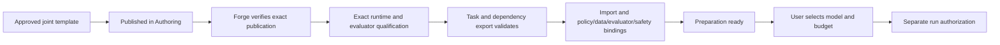

# Authoring → Forge execution handoff

Status: requirements and gap report requested by the Product Owner on 18 November
2026. Existing API paths below were checked against repository code; proposed
additions are not implemented or deployed merely because they appear here.
No live model calls or Authoring integration are enabled by this document.

## Intended experience

The user publishes an approved authored task and exports it to Forge. Authoring
checks the exact template/runtime contract and required dependencies before
export. Forge validates/imports the package, creates exact candidate bindings
where supported, and returns either a preparation-ready result or specific
actionable blockers. The user selects model/version, credentials and spending
limits separately. Nothing in template publication or export starts a benchmark.

Live integration removes manual file transport and repeated metadata entry. It
does not create absent policy text, approve applicability or data rights, qualify
an unfinished runtime, or grant spending authority. Those must be supplied or
completed by their actual owners. Manual ZIP and live export must use the same
validator and immutable binding rules.

Publication and readiness are distinct:

The template can be published for authoring while execution remains blocked;
that state must be visible before the user clicks Export for benchmarking.

## Responsibility boundary

| Owner | Must supply or verify |
|---|---|
| Authoring | Exact approved task/form/template revision; actor/private separation; original policy and input artifacts it owns; actual source/review references; export preflight and immutable package receipts. |
| Forge | Published execution-capability contract; registration/publication verification; installed runtime/evaluator qualification; restricted binding/materialization writers; original-input conservation; import/readiness receipts and durable execution controls. |
| Project Product Owner | Actual scoped domain/applicability, rights and other required approvals; model/budget choice and run approval. Optional additional reviews remain non-gating under D-SIMPLE. |

An authored-task approval cannot stand in for a policy applicability review or
installed runtime qualification. A transferred runtime receipt must originate in
Forge's qualification path; Authoring must not generate a passed runtime receipt.

## Existing API surfaces

All Forge paths below have the authenticated, project-scoped prefix
`/api/v1/projects/{project}/dataset-exports/generic`.

| Method/path | Existing purpose | Limitation |
|---|---|---|
| GET `/contracts` | Export schemas, template schema, capability catalogues, case datasets, limits and supported versions. | Not a complete dependency-bundle/readiness discovery contract today. |
| GET/POST `/templates` | List/register exact joint template versions. | Registration is not publication approval or qualification. |
| POST `/templates/{id}/qualify` | Evaluate actual current qualification and record its receipt. | Can correctly return blocked; installed runtime controls are required. |
| POST `/validate` | Validate raw `application/zip` export without starting execution. | Missing exact dependencies can yield unknown/blocked rather than invalid. |
| POST `/resolve` | Resolve a valid package under current bindings and private-storage assignment. | Does not manufacture missing reviews, runtime or paid authority. |
| GET `/praxis/contracts` | Forge server retrieves the Authoring template contract. | Requires the separately configured service identity/integration. |
| POST `/praxis/proposals` | Validate/propose a joint template to Authoring. | Does not publish or approve it. |
| POST `/praxis/proposals/{id}/accept-publication` | Retrieve and verify the exact authenticated published template response. | Informational offline JSON cannot be relabelled as that authenticated response. |
| GET `/praxis/events`, POST `/praxis/events/{id}/deliver` | Inspect/deliver durable qualification/revocation events. | Ambiguous outcomes need reconciliation, not blind retries. |

The workspace ZIP import entry is separately:
`POST /api/v1/projects/{project}/workspace/benchmark/import`.
It accepts the authored-export wire, authenticates the real Admin, validates the
package, and keeps private reference bytes in protected storage.

Forge's existing Authoring client uses the Authoring prefix
`/api/v1/integrations/anvil/templates` with GET `/contracts`, POST `/validate`,
POST `/proposals`, GET `/proposals/{id}`, and POST `/qualifications` for
qualification/revocation delivery. These are code-level interfaces, not a claim
that the current disabled integration has passed end-to-end tests.

## Required joint-template information

Keep one exact template identity/version and canonical joint-spec hash, with
separate authoring/execution/skills part hashes. Forge supplies execution
capabilities and accepted versions; Authoring supplies its approved authoring
profile and assigned identity. Changes produce explicit successor versions.

The execution contract must identify:

- Runtime/environment ID and version, tool schemas, bounded workflow/agent mode,
  input/output contracts, evaluator criteria/versions, reset/checkpoint semantics,
  isolation/network limits and resource limits.
- Input dataset requirements: schema/version, required source artifacts and
  immutable membership/snapshot identities, product selector, scope and quotas.
- Policy requirements: actual source artifacts versus reference-only descriptors,
  hash algorithm/canonicalization, public-text location, versions, publication
  provenance, effective intervals and applicability dimensions.
- Required rights/domain/runtime review subjects and acceptable receipt formats,
  expiry/revocation checks, trust owners and which checks remain outstanding.
- Actor-visible fields, grader-only fields and forbidden private-data paths.

The supported KYC product cohort can contain 1–4 distinct approved workflows, but
every row in the explicitly selected original input must remain accounted for.
A single individual workflow must not silently filter a mixed original input.
The runtime's separate all-product software qualification is not narrowed by a
single-product benchmark cohort.

## What Authoring must provide for KYC v7

Target: template `6d8f9cae-7c06-4c36-a207-522978d5486b`, version 7,
joint SHA `c8c4eddfed5d018f69a739bc0280538dd5011ce79d4e52ede77f6e101f248a8d`.

| Artifact | Required information | Current supplied state |
|---|---|---|
| Joint template | Complete spec and exact part hashes. | Received, validated and registered in QA. |
| Publication provenance | Authenticated published response or a separately supported verifiable offline proof. | Supplied record is informational; live verification is disabled. |
| Federal policy artifact | Original public source bytes, version, provenance, effective dates and exact hash/public-text projection. | Received separately as XML capture `07069b75...7bf1f4`; v7 still references descriptor `0c05f57a...af3fe`. New binding requires a successor; applicability/legal review remains pending. |
| State/applicability policies | Original applicable artifacts and exact product/state/charter/effective-interval mapping. | CA/NY/TX/FL/IL source/applicability reviews are explicitly pending. |
| Domain review evidence | Authenticated reviewer decision on the exact artifact set and applicability subject, with ID/hash, time, expiry and revocation lineage. | No such scoped approvals supplied. Workflow approval is distinct. |
| Input population | Original case/source artifact manifest, exact membership/snapshot hashes, assessment dates and source/rights review. | Separate 200-case/50-case bundle received; dataset, membership and case hashes verified. Population identity is explicitly the sorted case-ID array. Case/expectation and rights reviews remain pending. |
| Task export | Exact approved revision, actor JSON, form JSON, hidden reference/rubric and their hashes. | Received one individual-product task; other workflows must not be invented. |

The Golden Bank operating-choice file matches all seven v7 rule hashes and Forge's
existing library. Its owner-approved operating choices do not change the file's
explicitly pending state source/applicability reviews.

### Evidence bundle received 18 November

Local bundle: `golden-kyc-pilot/outputs/rlgym-offline-export/kyc-v7-policy-evidence-bundle`.
All 23 declared payload files match their manifest hashes and sizes; no missing or
undeclared payload files. Initial manifest SHA
`dd68f4c850c502b818bd6a18f368c47015ad5f61abb6424d77ebbc83d32acb94`;
after Authoring added checksum definitions, updated manifest SHA
`0e39c75004630077df6ef2b74f4424981869d69f5b3d2412925dcd4ebeeb695a`.
It provides the distinct federal XML capture (raw SHA
`07069b7552403b5b99097a9249d1ed45d940253df1bafa860154e52a097bf1f4`)
and confirms its source/applicability reviews remain pending. It is not bound in
v7. User explicitly instructs: no state policy bindings, no policy-qualified v7;
new federal/source bindings belong in a separately reviewed successor such as v8.
No successor has been created by Forge.

### Current request to send Authoring

The federal capture, bank rules and case files have been received; do not resend
them as if absent. Please provide or explicitly track as pending:

1. Original applicable state policy sources and the bank-charter applicability
   mapping, with versions, provenance, dates and exact source hashes.
2. Genuine scoped domain/applicability decisions and their authenticated receipt
   identities, expiry/revocation information; no replacement of pending with approved.
3. Case-expectation review and an explicit dataset/source-rights decision on the
   exact population and artifacts. Synthetic provenance is useful evidence, not
   a silently fabricated approval record.
4. Keep the now-verified sorted-ID population hash definition in the published
   dependency schema, with separate dataset and per-record content identities.
5. When those execution dependencies are approved, an explicit successor proposal
   such as v8 that references the new artifacts and binds their review subjects.
   Preserve v7 and its approved task; do not edit it in place or substitute the
   synthetic practice documents as public policy.

Runtime/technical-probe implementation and genuine installed qualification remain
Forge responsibilities; Authoring should consume those results, not manufacture them.

The 200-record canonical dataset hash verifies as
`e8d5cb8b4c84ec58049bba9259a04662fef732b536d3663bcfdb425fb7f74653`.
All 50 declared individual case IDs/hashes verify against original records, ten
per state. Dataset expectation/case reviews and a separate rights record remain
absent. Authoring clarified population hash
`c77748bc1d9ffad04b3174ff70801c0c1a86649f7949b666a766ab87d45e08aa`
as SHA-256 of RFC 8785 canonical JSON of the 50 case-ID strings sorted ascending.
That hash now independently verifies. The canonical 50-record hash
`34db46de...6b7e3` and membership-list hash `3b9d40d2...397ae` are different named
objects, not mismatches once the target is explicit. Content remains bound by the
full dataset SHA plus every per-case hash. Updated population-file raw SHA
`7f314220f1265854a8dd4c11cb834ede323d54ab52e70da4e663c2862c57c0c1`.
All 23 updated manifest entries verify; no task/template identity changed.

The bundle README's statement that v7 is not registered is stale relative to the
actual Forge Admin registration completed in this session. Registration exists;
qualification is still blocked. Live receipt/status synchronization should avoid
this cross-application ambiguity. Preserve the supplied evidence bundle unchanged.

Important hash distinction: the descriptor hash must remain the descriptor's
identity. Do not put legal/policy text behind that same hash. Provide its own exact
source artifact and hash, with a declared relation to the descriptor. If v7 cannot
express that dependency under its frozen schema, publish an explicit compatible
successor; do not rewrite v7, its approved task or existing receipts in place.

## Proposed additions—not existing APIs

These requirements need a versioned contract agreed between both applications:

1. **Dependency discovery/preflight:** a machine-readable response listing every
   required artifact, review subject and current capability/qualification receipt
   for the exact template and project. Include owner, blocking code and fix path.
2. **Versioned dependency bundle:** public policy sources and input manifests,
   exact hash/canonicalization metadata, review/provenance records and protected
   private assets. Supported embedded assets or authenticated immutable references
   must be declared by the negotiated schema. Do not add arbitrary undeclared
   files/fields to the current strict v1 task ZIP.
   Every checksum must declare its target (raw file, canonical object, ordered
   record array or membership projection), algorithm, ordering and canonicalization
   version. Descriptor hashes, normative-source hashes and population hashes must
   be separate named identities with explicit relations.
3. **Authenticated scoped review capture/resolution:** genuine current domain and
   runtime review records covering exact source, product/state/charter/interval,
   runtime image/source, template, frozen preparation and input. UUID/hash-shaped
   strings alone are insufficient. Expiry/revocation must propagate.
4. **Binding preparation and readiness receipt:** after validation/import, derive
   exact policy/data/environment/evaluator/safety bindings and return their IDs,
   versions, subject hashes and unresolved requirements. No generic ready boolean
   may conceal missing components or create paid authority.
5. **Synchronized status:** Authoring displays Forge execution qualification and
   blockers before export; Forge displays import/binding status after export.
   Published, validated, imported, preparation-ready and run-authorized are separate.

Proposed response sections should include template/package identity, structural
validation, publication verification, dependency completeness, review status,
runtime status, binding status and spending/dispatch authority. This is a logical
response design, not permission to add unsupported fields to current schemas.

## Forge work that live integration will not fix

- Complete the native technical-probe owner/admission and actual normal/crash,
  role/mount, MCP/reset, checkpoint, OPA/ZEN and private-scoring controls.
- Independently review/install genuine current-source/image qualification evidence.
- Implement authenticated exact-scope policy-review resolution and the separate
  restricted `anvil_kyc_qualifier` producer/materialization path.
- Complete/test the versioned dependency handoff and automatic binding preparation.
- Verify service identity, project isolation, rights, hidden-reference isolation,
  idempotency, revocation and ambiguous-outcome handling end-to-end.

Do not export provider secrets, model keys, SQL credentials or grader-only
reference material into actor/model inputs. No export/qualification endpoint
should select a model or dispatch a provider request.

## Acceptance checks before enabling live export

- A fresh authorized QA project negotiates contracts and registers/verifies the
  exact published template without manual database changes or file copying.
- Missing policy text, reference-only descriptors, stale/revoked reviews,
  unsupported profiles and incomplete input coverage fail preflight with exact
  owner/fix information before an execution-ready export is claimed.
- A complete approved bundle imports through the same validator as manual ZIP,
  preserves original task/input identities and produces exact immutable bindings.
- Changed case content with unchanged case IDs must invalidate its content binding;
  the sorted-ID population hash alone is not a case-content identity.
- Replaying the same successful import with its original idempotency key creates
  no duplicate task/profile/binding. Uncertain delivery is reconciled explicitly.
- Cross-project artifacts and private-reference leakage are rejected; actor and
  grader projections are inspected separately.
- A template/profile successor never inherits obsolete qualification or approvals.
- Expired/revoked qualification blocks new preparation and is visible in Authoring.
- With model calls disabled, no request reaches a provider and no fixture answer
  is reported as model performance. User model/budget/run approval remains separate.

Sources: `praxis_generic_api.py`, `dataset_export_api.py`, `praxis_template_client.py`,
`praxis_project_intake.py`, `golden_kyc_policy_registry.py`,
`golden_kyc_policy_delivery.py`, `golden_component_qualification.py` and the actual
KYC v7 files/QA observations recorded in the 18 November generated reports.
